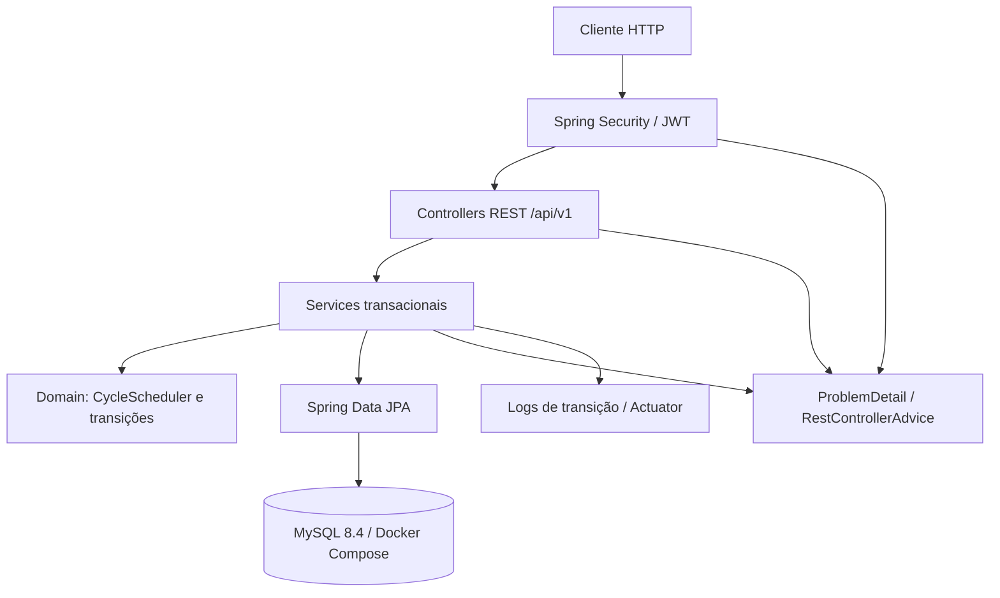
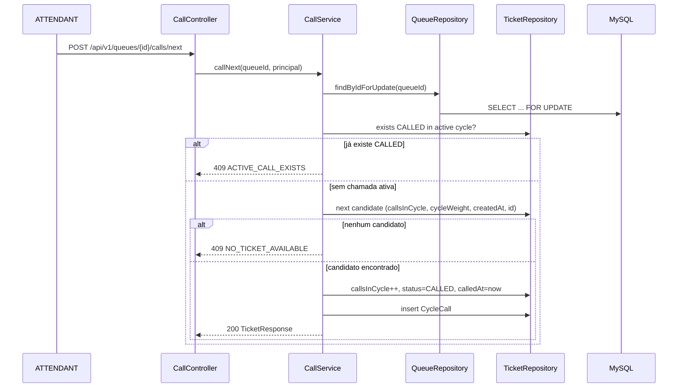

# Gerenciamento de Filas Cíclicas Design

**Spec**: `.specs/features/gerenciamento-filas-ciclicas/spec.md`
**Status**: Draft - awaiting user review

---

## Architecture Overview

Monólito modular em camadas, sem dependência de serviços externos. A API recebe requisições autenticadas, os controllers validam o contrato, os services executam as regras de ciclo dentro de uma transação, o domínio calcula a próxima chamada e os repositories persistem no MySQL. O MySQL roda em Docker Compose; a aplicação roda via Maven com Flyway aplicando o schema no startup.



### Fluxo de chamada do próximo ticket



---

## Code Reuse Analysis

Projeto greenfield: o diretório está vazio, não há código, convenções ou componentes existentes para reaproveitar.

### Existing Components to Leverage

| Component | Location | How to Use |
| --- | --- | --- |
| Nenhum | - | Projeto novo; criar estrutura a partir deste design |

### Integration Points

| System | Integration Method |
| --- | --- |
| MySQL 8.4 | JDBC via Spring Data JPA; schema por Flyway; `docker compose up` |
| Docker Compose | Serviço `mysql` com healthcheck e volume nomeado |
| Actuator | `/actuator/health` e `/actuator/info` |
| JWT | Spring Security OAuth2 Resource Server + Nimbus JOSE |

---

## Components

### Config / Bootstrap

- **Purpose**: Subir a aplicação, configurar datasource, Flyway, Jackson, Actuator e profiles.
- **Location**: `src/main/java/com/fila/ciclica/` e `src/main/resources/application.yml`
- **Interfaces**:
  - `FilaCiclicaApplication.main(String[] args)` - entrypoint.
- **Dependencies**: Spring Boot 4.1.2, MySQL driver, Flyway, Actuator.
- **Reuses**: Nenhum.

### Security

- **Purpose**: Autenticar credenciais, emitir e validar JWT HS256 e aplicar papéis.
- **Location**: `src/main/java/com/fila/ciclica/security/`
- **Interfaces**:
  - `TokenService.issue(User user): TokenResponse` - gera JWT com `sub`, `role`, `iat`, `exp`.
  - `JwtDecoder` - valida assinatura e expiração.
  - `SecurityFilterChain` - rotas públicas (`/api/v1/auth/login`, `/actuator/health`) e proteção das demais.
  - `AdminSeedRunner.run(ApplicationArguments args)` - cria o ADMIN inicial se ausente.
- **Dependencies**: Spring Security, Nimbus JOSE, BCrypt, `UserRepository`.
- **Reuses**: Entidade `User`.

### User API / Service

- **Purpose**: CRUD de usuários e ativação/desativação.
- **Location**: `src/main/java/com/fila/ciclica/api/user/`
- **Interfaces**:
  - `POST /api/v1/users` (ADMIN)
  - `GET /api/v1/users?page=&size=` (ADMIN)
  - `GET /api/v1/users/{id}` (ADMIN)
  - `PATCH /api/v1/users/{id}/status` (ADMIN)
- **Dependencies**: `UserRepository`, `PasswordEncoder`, validação.
- **Reuses**: `ProblemDetail` handler.

### Queue API / Service

- **Purpose**: Criar, atualizar, desativar e consultar filas e o estado do ciclo.
- **Location**: `src/main/java/com/fila/ciclica/api/queue/`
- **Interfaces**:
  - `POST /api/v1/queues` (ADMIN)
  - `GET /api/v1/queues?active=&page=&size=` (autenticado)
  - `GET /api/v1/queues/{id}` (autenticado)
  - `PUT /api/v1/queues/{id}` (ADMIN)
  - `DELETE /api/v1/queues/{id}` (ADMIN; desativa)
  - `GET /api/v1/queues/{id}/state` (autenticado)
- **Dependencies**: `QueueRepository`, `CycleRepository`, `TicketRepository`.
- **Reuses**: Entidades `Queue`, `Cycle`, `Ticket`.

### Ticket API / Service

- **Purpose**: Criar tickets com código e snapshot de peso, listar, alterar prioridade e cancelar.
- **Location**: `src/main/java/com/fila/ciclica/api/ticket/`
- **Interfaces**:
  - `POST /api/v1/queues/{queueId}/tickets` (ADMIN, ATTENDANT)
  - `GET /api/v1/queues/{queueId}/tickets?status=&priority=&page=&size=` (autenticado)
  - `GET /api/v1/tickets/{publicId}` (autenticado)
  - `PATCH /api/v1/tickets/{publicId}/priority` (ADMIN, ATTENDANT)
  - `DELETE /api/v1/tickets/{publicId}` (ADMIN, ATTENDANT; cancela)
- **Dependencies**: `TicketRepository`, `QueueRepository`, `CycleScheduler`.
- **Reuses**: `Ticket`, `Cycle`, `Priority`.

### Call API / Service

- **Purpose**: Chamar próximo, concluir, registrar "não atendeu", marcar NO_SHOW e fechar/abrir ciclos.
- **Location**: `src/main/java/com/fila/ciclica/api/call/`
- **Interfaces**:
  - `POST /api/v1/queues/{queueId}/calls/next`
  - `POST /api/v1/tickets/{publicId}/complete`
  - `POST /api/v1/tickets/{publicId}/no-answer`
  - `POST /api/v1/tickets/{publicId}/no-show`
  - `GET /api/v1/queues/{queueId}/cycle` (resumo do ciclo ativo)
- **Dependencies**: `QueueRepository`, `TicketRepository`, `CycleRepository`, `CycleCallRepository`.
- **Reuses**: `CycleScheduler`.

### Domain

- **Purpose**: Regras puras de seleção e ciclo, testáveis sem Spring.
- **Location**: `src/main/java/com/fila/ciclica/domain/`
- **Interfaces**:
  - `CycleScheduler.selectNext(List<Ticket> candidates): Optional<Ticket>`
  - `CycleScheduler.shouldCloseCycle(List<Ticket> tickets): boolean`
  - `CycleScheduler.applyNoAnswer(Ticket ticket): TicketStatus`
  - `Queue.weightFor(Priority priority): int`
- **Dependencies**: Entidades e enums do domínio.
- **Reuses**: Nenhum.

### Repositories

- **Purpose**: Persistência e queries de lock/seleção.
- **Location**: `src/main/java/com/fila/ciclica/repository/`
- **Interfaces**:
  - `QueueRepository.findByIdForUpdate(Long id): Optional<Queue>` com `@Lock(PESSIMISTIC_WRITE)`.
  - `TicketRepository.findNextCandidate(Long cycleId): Optional<Ticket>` com ordenação por `callsInCycle asc, cycleWeight desc, createdAt asc, id asc`.
  - `TicketRepository.existsByCycleIdAndStatus(Long cycleId, TicketStatus status): boolean`.
  - `CycleRepository.findByActiveQueueId(Long queueId): Optional<Cycle>`.
- **Dependencies**: Spring Data JPA, MySQL.
- **Reuses**: Entidades.

### Common / Errors

- **Purpose**: Exceções de domínio, ProblemDetail, validação e paginação.
- **Location**: `src/main/java/com/fila/ciclica/common/`
- **Interfaces**:
  - `ApiException(code, status, detail)`.
  - `GlobalExceptionHandler` para validação, regras, 401/403, 404, 409, 500.
  - `PageResponse<T>` com `content`, `page`, `size`, `totalElements`, `totalPages`.
- **Dependencies**: Spring Web, Bean Validation.
- **Reuses**: Nenhum.

### Test Support

- **Purpose**: Base Testcontainers MySQL e impressão de provas por teste.
- **Location**: `src/test/java/com/fila/ciclica/support/`
- **Interfaces**:
  - `AbstractIntegrationTest` com `@SpringBootTest`, `@AutoConfigureMockMvc`, MySQL `mysql:8.4` e `@DynamicPropertySource`.
  - `ProofReporter implements TestWatcher` - imprime `PROOF PASSED: <displayName>` em teste bem-sucedido.
- **Dependencies**: Testcontainers, JUnit 5, Spring Boot Test.
- **Reuses**: Configuração da aplicação.

---

## Data Models (if applicable)

### Enums

```java
enum Role { ADMIN, ATTENDANT }
enum Priority { NORMAL, PREFERENTIAL, URGENT }
enum TicketStatus { WAITING, CALLED, COMPLETED, NO_SHOW, CANCELLED }
enum CycleStatus { ACTIVE, CLOSED }
```

### User

```java
class User {
  Long id;
  String name;
  String email;          // unique, lowercase
  String passwordHash;   // BCrypt
  Role role;
  boolean active;
  Instant createdAt;
  Instant updatedAt;
}
```

### Queue

```java
class Queue {
  Long id;
  String name;           // unique
  String prefix;         // unique, 1..8 uppercase alphanumeric
  String description;
  boolean active;
  int weightNormal;      // default 1
  int weightPreferential;// default 2
  int weightUrgent;      // default 3
  long ticketCounter;    // next ticket number, incremented under queue lock
  Instant createdAt;
  Instant updatedAt;
  long version;
}
```

**Relationships**: Uma fila tem muitos ciclos, tickets e chamadas.

### Cycle

```java
class Cycle {
  Long id;
  Queue queue;
  int number;            // 1..N, unique per queue
  CycleStatus status;    // ACTIVE or CLOSED
  Long activeQueueId;    // equals queue.id while ACTIVE; null when CLOSED; unique
  Instant startedAt;
  Instant closedAt;
}
```

`activeQueueId` com índice único garante no máximo um ciclo ACTIVE por fila no MySQL (múltiplos NULL são permitidos).

### Ticket

```java
class Ticket {
  Long id;
  UUID publicId;         // unique, exposto na API
  Queue queue;
  Cycle cycle;           // ciclo atual do ticket
  String code;           // PREFIX-NNNN, unique per queue
  String customerName;
  Priority priority;
  TicketStatus status;
  int callsInCycle;      // chamadas já feitas no ciclo atual
  int cycleWeight;       // snapshot do peso da prioridade ao entrar no ciclo
  String externalReference; // optional, unique per queue
  Instant calledAt;
  Instant finishedAt;
  Instant createdAt;
  Instant updatedAt;
  long version;
}
```

### CycleCall

```java
class CycleCall {
  Long id;
  Cycle cycle;
  Ticket ticket;
  User attendant;
  int sequenceNumber;    // unique per cycle
  Instant calledAt;
}
```

**Relationships**: `CycleCall` registra cada chamada para operar o ciclo e provar a ordem; não há endpoint de histórico no MVP.

### Schema DDL (V1)

```sql
CREATE TABLE users (
  id BIGINT AUTO_INCREMENT PRIMARY KEY,
  name VARCHAR(120) NOT NULL,
  email VARCHAR(180) NOT NULL,
  password_hash VARCHAR(100) NOT NULL,
  role VARCHAR(20) NOT NULL,
  active BOOLEAN NOT NULL DEFAULT TRUE,
  created_at DATETIME(6) NOT NULL,
  updated_at DATETIME(6) NOT NULL,
  CONSTRAINT uk_users_email UNIQUE (email)
);

CREATE TABLE queues (
  id BIGINT AUTO_INCREMENT PRIMARY KEY,
  name VARCHAR(120) NOT NULL,
  prefix VARCHAR(8) NOT NULL,
  description VARCHAR(500),
  active BOOLEAN NOT NULL DEFAULT TRUE,
  weight_normal INT NOT NULL DEFAULT 1,
  weight_preferential INT NOT NULL DEFAULT 2,
  weight_urgent INT NOT NULL DEFAULT 3,
  ticket_counter BIGINT NOT NULL DEFAULT 0,
  created_at DATETIME(6) NOT NULL,
  updated_at DATETIME(6) NOT NULL,
  version BIGINT NOT NULL DEFAULT 0,
  CONSTRAINT uk_queues_name UNIQUE (name),
  CONSTRAINT uk_queues_prefix UNIQUE (prefix)
);

CREATE TABLE cycles (
  id BIGINT AUTO_INCREMENT PRIMARY KEY,
  queue_id BIGINT NOT NULL,
  number INT NOT NULL,
  status VARCHAR(20) NOT NULL,
  active_queue_id BIGINT NULL,
  started_at DATETIME(6) NOT NULL,
  closed_at DATETIME(6) NULL,
  CONSTRAINT fk_cycles_queue FOREIGN KEY (queue_id) REFERENCES queues(id),
  CONSTRAINT uk_cycles_queue_number UNIQUE (queue_id, number),
  CONSTRAINT uk_cycles_active_queue UNIQUE (active_queue_id)
);

CREATE TABLE tickets (
  id BIGINT AUTO_INCREMENT PRIMARY KEY,
  public_id CHAR(36) NOT NULL,
  queue_id BIGINT NOT NULL,
  cycle_id BIGINT NOT NULL,
  code VARCHAR(20) NOT NULL,
  customer_name VARCHAR(120) NOT NULL,
  priority VARCHAR(20) NOT NULL,
  status VARCHAR(20) NOT NULL,
  calls_in_cycle INT NOT NULL DEFAULT 0,
  cycle_weight INT NOT NULL,
  external_reference VARCHAR(120) NULL,
  called_at DATETIME(6) NULL,
  finished_at DATETIME(6) NULL,
  created_at DATETIME(6) NOT NULL,
  updated_at DATETIME(6) NOT NULL,
  version BIGINT NOT NULL DEFAULT 0,
  CONSTRAINT fk_tickets_queue FOREIGN KEY (queue_id) REFERENCES queues(id),
  CONSTRAINT fk_tickets_cycle FOREIGN KEY (cycle_id) REFERENCES cycles(id),
  CONSTRAINT uk_tickets_public_id UNIQUE (public_id),
  CONSTRAINT uk_tickets_queue_code UNIQUE (queue_id, code),
  CONSTRAINT uk_tickets_queue_external_ref UNIQUE (queue_id, external_reference)
);

CREATE TABLE cycle_calls (
  id BIGINT AUTO_INCREMENT PRIMARY KEY,
  cycle_id BIGINT NOT NULL,
  ticket_id BIGINT NOT NULL,
  attendant_id BIGINT NOT NULL,
  sequence_number INT NOT NULL,
  called_at DATETIME(6) NOT NULL,
  CONSTRAINT fk_calls_cycle FOREIGN KEY (cycle_id) REFERENCES cycles(id),
  CONSTRAINT fk_calls_ticket FOREIGN KEY (ticket_id) REFERENCES tickets(id),
  CONSTRAINT fk_calls_attendant FOREIGN KEY (attendant_id) REFERENCES users(id),
  CONSTRAINT uk_calls_cycle_sequence UNIQUE (cycle_id, sequence_number)
);
```

---

## Domain Rules

### Próximo ticket

```text
selectNext(cycle):
  if exists ticket in cycle with status CALLED:
      throw ActiveCallExists
  candidates = tickets in cycle
      where status = WAITING
        and callsInCycle < cycleWeight
  if candidates is empty:
      throw NoTicketAvailable
  return candidates sorted by:
      callsInCycle ASC,
      cycleWeight DESC,
      createdAt ASC,
      id ASC
  first
```

### "Não atendeu" (`no-answer`)

```text
applyNoAnswer(ticket):
  require ticket.status == CALLED
  if ticket.callsInCycle < ticket.cycleWeight:
      ticket.status = WAITING
  else:
      ticket.status = NO_SHOW
  closeCycleIfDone(ticket.cycle)
```

O peso, portanto, é o número máximo de chamadas por ciclo. Um ticket URGENT com peso 3 pode ser chamado, devolvido à fila e chamado de novo até três vezes; na terceira ausência ele sai como NO_SHOW e volta no ciclo seguinte.

### Conclusão, NO_SHOW explícito e cancelamento

```text
complete(ticket):      require CALLED; status = COMPLETED; finishedAt = now; closeCycleIfDone
noShow(ticket):        require CALLED; status = NO_SHOW; closeCycleIfDone
cancel(ticket):        require WAITING or CALLED; status = CANCELLED; finishedAt = now; closeCycleIfDone
```

### Fechamento e abertura do ciclo

```text
closeCycleIfDone(cycle):
  if count(cycle, status in [WAITING, CALLED]) > 0: return
  cycle.status = CLOSED
  cycle.closedAt = now
  cycle.activeQueueId = null
  next = new Cycle(queue, cycle.number + 1, ACTIVE, activeQueueId = queue.id)
  save next
  for ticket in cycle where status == NO_SHOW:
      ticket.cycle = next
      ticket.status = WAITING
      ticket.callsInCycle = 0
      ticket.calledAt = null
      ticket.cycleWeight = queue.weightFor(ticket.priority)
      save ticket
```

Um ciclo só fecha quando não há mais ticket WAITING nem CALLED. Tickets COMPLETED, CANCELLED e NO_SHOW não bloqueiam o fechamento.

### Criação de ticket

```text
createTicket(queueId, request):
  queue = queueRepository.findByIdForUpdate(queueId)  // serializa o contador
  require queue.active
  if request.externalReference != null:
      existing = ticketRepository.findByQueueIdAndExternalReference(...)
      if existing != null: return existing (HTTP 200)
  cycle = cycleRepository.findByActiveQueueId(queue.id)
  queue.ticketCounter++
  ticket.code = queue.prefix + "-" + zeroPad(queue.ticketCounter, 4)
  ticket.status = WAITING
  ticket.callsInCycle = 0
  ticket.cycleWeight = queue.weightFor(request.priority)
  ticket.cycle = cycle
  save ticket
```

### Consulta e ordenação

- Filas e tickets usam paginação `page` (0-based) e `size` (default 20, máximo 100), ordenados por `createdAt desc` salvo indicação contrária.
- Usuários são ordenados por `name asc`.
- A listagem de tickets pode filtrar por `status` e `priority`; a listagem de filas por `active`.

---

## API Contract Summary

| Method | Path | Role | Success | Main errors |
| --- | --- | --- | --- | --- |
| POST | `/api/v1/auth/login` | público | 200 token | 401 INVALID_CREDENTIALS |
| POST | `/api/v1/users` | ADMIN | 201 | 409 DUPLICATE_EMAIL |
| GET | `/api/v1/users` | ADMIN | 200 page | 400 |
| GET | `/api/v1/users/{id}` | ADMIN | 200 | 404 |
| PATCH | `/api/v1/users/{id}/status` | ADMIN | 200 | 404 |
| POST | `/api/v1/queues` | ADMIN | 201 | 400, 409 DUPLICATE_QUEUE |
| GET | `/api/v1/queues` | autenticado | 200 page | 400 |
| GET | `/api/v1/queues/{id}` | autenticado | 200 | 404 |
| PUT | `/api/v1/queues/{id}` | ADMIN | 200 | 400, 404 |
| DELETE | `/api/v1/queues/{id}` | ADMIN | 204 | 409 QUEUE_HAS_ACTIVE_TICKETS |
| GET | `/api/v1/queues/{id}/state` | autenticado | 200 | 404 |
| POST | `/api/v1/queues/{queueId}/tickets` | ADMIN, ATTENDANT | 201 ou 200 idempotente | 400, 409 QUEUE_INACTIVE |
| GET | `/api/v1/queues/{queueId}/tickets` | autenticado | 200 page | 400, 404 |
| GET | `/api/v1/tickets/{publicId}` | autenticado | 200 | 404 |
| PATCH | `/api/v1/tickets/{publicId}/priority` | ADMIN, ATTENDANT | 200 | 409 PRIORITY_LOCKED |
| DELETE | `/api/v1/tickets/{publicId}` | ADMIN, ATTENDANT | 204 | 409 INVALID_STATE |
| POST | `/api/v1/queues/{queueId}/calls/next` | ADMIN, ATTENDANT | 200 | 409 ACTIVE_CALL_EXISTS, NO_TICKET_AVAILABLE |
| POST | `/api/v1/tickets/{publicId}/complete` | ADMIN, ATTENDANT | 200 | 409 INVALID_STATE |
| POST | `/api/v1/tickets/{publicId}/no-answer` | ADMIN, ATTENDANT | 200 | 409 INVALID_STATE |
| POST | `/api/v1/tickets/{publicId}/no-show` | ADMIN, ATTENDANT | 200 | 409 INVALID_STATE |
| GET | `/api/v1/queues/{queueId}/cycle` | autenticado | 200 | 404 |
| GET | `/actuator/health` | público | 200 | - |

---

## Error Handling Strategy

| Error Scenario | Handling | User Impact |
| --- | --- | --- |
| Validação de corpo/query | `MethodArgumentNotValidException` → 400 `VALIDATION_ERROR` com `fields` | Sabe exatamente qual campo corrigir |
| Credenciais inválidas | `BadCredentialsException` → 401 `INVALID_CREDENTIALS` | Não revela se o e-mail existe |
| JWT ausente/inválido/expirado | `AuthenticationEntryPoint` → 401 `UNAUTHORIZED` | Precisa autenticar novamente |
| Papel insuficiente | `AccessDeniedHandler` → 403 `FORBIDDEN` | Sabe que não tem permissão |
| Fila/ticket/usuário inexistente | `ApiException` 404 com código específico | Identifica o recurso |
| Chamada ativa | 409 `ACTIVE_CALL_EXISTS` | Conclui ou registra ausência antes de chamar outro |
| Sem candidato | 409 `NO_TICKET_AVAILABLE` | Sabe que o ciclo não tem ticket elegível |
| Transição inválida | 409 `INVALID_STATE` | Corrige a ação |
| Conflito de versão/lock | `ObjectOptimisticLockingFailureException` → 409 `CONCURRENT_UPDATE` | Repete a operação |
| Violação de unicidade | 409 com código específico | Corrige nome/prefixo/e-mail/referência |
| Erro inesperado | 500 `INTERNAL_ERROR`, log com stack trace | Mensagem genérica, sem vazamento |

Formato RFC 9457:

```json
{
  "type": "about:blank",
  "title": "Conflict",
  "status": 409,
  "detail": "Queue already has an active call.",
  "instance": "/api/v1/queues/1/calls/next",
  "code": "ACTIVE_CALL_EXISTS",
  "fields": []
}
```

---

## Concurrency and Consistency

- **Lock por fila**: `QueueRepository.findByIdForUpdate` usa `PESSIMISTIC_WRITE` (`SELECT ... FOR UPDATE`) em toda operação que altera o contador de tickets, chama o próximo ou fecha o ciclo. Isso serializa as operações concorrentes da mesma fila.
- **Uma chamada ativa**: a verificação `existsByCycleIdAndStatus(CALLED)` e a criação da chamada acontecem dentro do mesmo lock/transação.
- **Ciclo ativo único**: `cycles.active_queue_id` tem índice único; o fechamento zera o campo antes de inserir o próximo ciclo.
- **Otimista em tickets**: `@Version` em `Ticket` detecta edições concorrentes fora do lock da fila (ex.: prioridade e cancelamento) e retorna 409.
- **Idempotência**: `externalReference` único por fila; a segunda criação concorrente recebe a violação de unicidade e o service busca o ticket existente para retornar 200.
- **Transações**: `@Transactional` nos services; nenhuma chamada externa dentro da transação.

---

## Security

- **Senhas**: BCrypt com custo padrão do Spring Security; validação de 8 a 72 caracteres (limite do BCrypt).
- **JWT**: HS256, segredo `JWT_SECRET` com no mínimo 32 caracteres, expiração 3600 s, claims `sub` (e-mail), `role`, `iat`, `exp`.
- **Seed**: `ADMIN_EMAIL` e `ADMIN_PASSWORD` obrigatórios no startup; cria o ADMIN se não existir, nunca sobrescreve senha existente.
- **Papéis**: `ADMIN` para filas e usuários; `ADMIN` e `ATTENDANT` para tickets e chamadas. Leitura de filas/tickets exige autenticação.
- **Respostas**: DTOs nunca expõem `passwordHash`.
- **Rate limiting**: fora do MVP; documentado como N/A.

---

## Risks & Concerns

| Concern | Location | Impact | Mitigation |
| --- | --- | --- | --- |
| Duas chamadas concorrentes criarem dois CALLED | `CallService.callNext` | Violação da regra de uma chamada ativa | Lock pessimista por fila + teste de concorrência C35 |
| Drift entre memória e banco no fechamento do ciclo | `CycleLifecycleService` | Ciclo preso ou dois ciclos ativos | Fechamento dentro da mesma transação/lock; índice único `active_queue_id` |
| Mudança de pesos no meio do ciclo | `QueueService.update` | Tickets mudarem de comportamento no meio do ciclo | Snapshot `ticket.cycleWeight`; novos pesos só para novos tickets/ciclos |
| N+1 na listagem de tickets/ciclos | `TicketRepository` | Latência em filas grandes | Projeções/paginação; `@EntityGraph` quando necessário |
| Segredo JWT fraco ou ausente | `application.yml` | Tokens forjáveis ou app não sobe | Falha rápida no startup se `JWT_SECRET` tiver menos de 32 caracteres |
| Senha do admin em variável de ambiente | `AdminSeedRunner` | Credencial vazada em log/arquivo | Não logar senha; documentar troca no README |
| MySQL ainda inicializando quando a API sobe | `compose.yaml` | API falha no startup | Healthcheck no Compose + retry de conexão do Hikari/Flyway |
| Testcontainers sem Docker | `AbstractIntegrationTest` | Suíte de integração vermelha | Documentar Docker requerido; build gate depende dele |
| Fuso horário inconsistente | Datas | Ordenação/ciclo errados | `DATETIME(6)` em UTC, `spring.jackson.time-zone=UTC`, `connectionTimeZone=UTC` |
| Fila desativada com ticket ativo | `QueueService.deactivate` | Ticket órfão ou chamada impossível | 409 `QUEUE_HAS_ACTIVE_TICKETS`; teste C15 |
| Exclusão física acidental | Repositories | Perda de histórico do ciclo | Sem endpoint de hard delete; cancelamento/desativação lógica |

---

## Tech Decisions (only non-obvious ones)

| Decision | Choice | Rationale |
| --- | --- | --- |
| Versão do Spring Boot | 4.1.2 (última estável no Maven Central em 2026-11-08) | Java 21 suportado; evita RC/M |
| Build tool | Maven com wrapper | Padrão previsível em Spring Boot; comandos simples para os gates |
| Banco local | `mysql:8.4` no Docker Compose | LTS, compatível com o driver gerenciado pelo Boot |
| Migrações | Flyway `V1__init_schema.sql` | Schema versionado e aplicado no startup |
| JWT | Spring Security OAuth2 Resource Server + Nimbus JOSE | Evita dependência extra (JJWT) e usa a stack oficial |
| Mapeamento | Manual, sem Lombok/MapStruct | Menos annotation processing e dependências no MVP |
| Lock | Pessimista na linha da fila | Serializa chamadas e contador; simples de provar |
| IDs públicos | UUID para ticket; BIGINT interno | Não expõe volume/sequência e facilita URL |
| Erros | RFC 9457 ProblemDetail | Padrão Spring 6+/Boot 4, testável |
| Testes | JUnit 5 + MockMvc + Testcontainers MySQL | Integração real com o mesmo banco do Compose |
| Provas | `ProofReporter` (TestWatcher) imprime `PROOF PASSED: <displayName>` | Permite proof por critério no `check_proofs.py` |
| Documentação | README com curl; sem OpenAPI | Escopo do MVP e evita dependência de springdoc |

> **Project-level decisions:** registradas em `.specs/STATE.md` como AD-001 a AD-007.

---

## Testing Strategy

- **Unitários**: `CycleSchedulerTest` cobre a ordenação, o limite de tentativas e o fechamento de ciclo com objetos em memória.
- **Integração**: `AbstractIntegrationTest` sobe MySQL 8.4 via Testcontainers, aplica Flyway e usa MockMvc com segurança real (JWT emitido no login).
- **Concorrência**: `CallNextConcurrencyIT` dispara duas chamadas simultâneas com `ExecutorService` e `CountDownLatch`; uma deve receber 200 e a outra 409.
- **E2E**: `CyclicQueueE2EIT` percorre criação de fila, tickets, chamadas, ausências, fechamento e reabertura do ciclo.
- **Provas**: cada teste relevante tem `@DisplayName("C<n> ...")` e `@ExtendWith(ProofReporter.class)`; o `check_proofs.py` lê a linha `PROOF PASSED: C<n> ...`.
- **Comandos**: unitários `mvn test`; integração `mvn verify`; build completo `mvn -q verify`.
